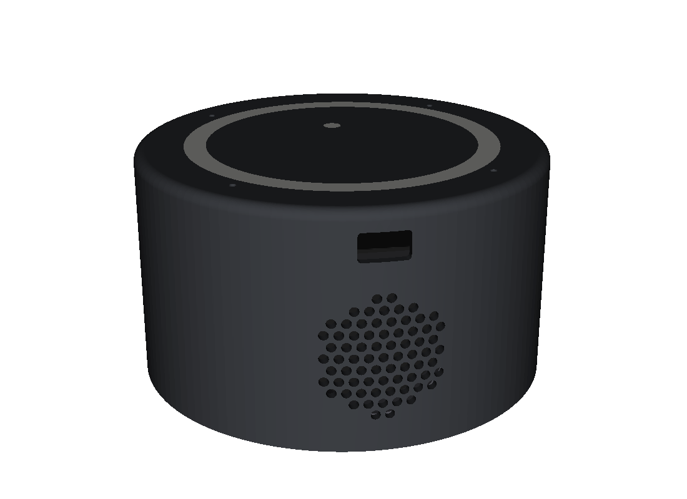

# Seneca – a DIY ChatGPT voice speaker

<p align="center"></p>

A small smart speaker that talks to **ChatGPT's voice mode** in full duplex. Say "Seneca", talk,
interrupt it whenever you like. It runs on a **Seeed ReSpeaker XVF3800 (4-mic array with hardware
echo cancellation) + XIAO ESP32-S3**. Audio goes straight from the device to ChatGPT over WebRTC.
It uses your ChatGPT subscription, so there are no per-minute API costs.

```
             ┌──────────── WebRTC (Opus audio + data channel) ───────────┐
             │                                                            ▼
 ReSpeaker XVF3800 + XIAO ESP32-S3                          ChatGPT voice (/realtime/wm)
 wake word · AEC · Opus · setup page                                     ▲
             │                                                            │
             └── WireGuard (sign-in + SDP over HTTP) ──► home relay ──────┘ (HTTPS)
             │
             └── AirPlay 2 (optional) ──► HomePod / AirPlay speaker
```

> ⚠️ **Unofficial.** This uses `chatgpt.com/realtime/wm`, the private endpoint behind ChatGPT's
> web voice mode. It is undocumented, can change or break at any time, and is not affiliated with
> or endorsed by OpenAI. Use it with your own account, for personal use, at your own risk.

## Features

- **Hands-free, full-duplex conversation.** On-device wake word "Seneca" (microWakeWord, TFLite
  Micro). You can interrupt it mid-sentence, and "Seneca, stop" ends the call.
- **Hardware echo cancellation.** The XVF3800 removes the speaker's own voice from the mics, so the
  assistant does not hear itself.
- **No server costs.** The ESP32 holds the ChatGPT web session and does sign-in and WebRTC
  itself. A tiny relay on an always-on machine at home forwards only the sign-in/SDP HTTP requests,
  because chatgpt.com challenges the ESP32's TLS fingerprint. Voice audio never touches the relay.
- **AirPlay 2 output (optional).** Plays the conversation on a HomePod or other AirPlay speaker,
  during calls and with barge-in. The echo canceller still works: the device feeds the XVF3800 a
  sample-exact copy of what the AirPlay speaker is playing, and measures that speaker's delay
  acoustically.
- **Local setup page.** Sign in, start/stop calls, mute, set volume, voice boost and EQ, pick an
  AirPlay speaker, test the wake word, and view microphone/speaker diagnostics.
- **Audio robustness.** Adaptive jitter buffer with pause stretching for bursty network delivery,
  plus a soft limiter.
- **3D-printable enclosure.** Parametric CadQuery model. Every assembly step is collision-checked
  in the model.

## Hardware

| Part | Notes |
|---|---|
| Seeed **reSpeaker XVF3800 4-mic array with XIAO ESP32-S3** | XVF3800 runs the I2S 16 kHz firmware |
| Seeed **Mono Enclosed Speaker 4 Ω 5 W** | on the board's speaker connector (or a powered speaker on the 3.5 mm jack) |
| USB-C power supply | |
| Optional: HomePod / AirPlay 2 speaker | |
| An always-on computer at home | runs the relay (macOS scripts included; anything that runs Python + WireGuard works) |
| Enclosure hardware | heat-set inserts, M2/M3 screws, 3 mm EPDM foam; see [enclosure/](enclosure/README.md) |

## Repository layout

| Path | What |
|---|---|
| [`firmware/`](firmware/README.md) | ESP-IDF 5.5 firmware: wake word, WebRTC, ChatGPT sign-in, setup page, AirPlay sender, XVF3800 control |
| [`firmware/components/speaker_core/`](firmware/components/speaker_core/README.md) | Portable, host-tested core: session state machine, data-channel events, cookie handling, request building |
| [`relay/`](relay/README.md) | Home relay: userspace WireGuard endpoint (wireproxy) + a minimal allow-listed HTTP relay + UPnP port mapping |
| [`wakeword/`](wakeword/seneca/README.md) | The "Seneca" wake-word model and its reproducible training recipe |
| [`enclosure/`](enclosure/README.md) | Parametric CadQuery enclosure, assembly checks and a browser 3D viewer |
| [`docs/`](docs/) | Hardware bring-up guide, board annotations, protocol research notes |
| [`signaling/`](signaling/) | Browser/Node prototype used to reverse-engineer the protocol (not needed for the device) |
| [`tools/fake-speaker/`](tools/fake-speaker/README.md) | Headless Python stand-in for the device, used to learn the protocol before the hardware existed |
| [`config/`](config/README.md) | Optional remote device config (for adapting to web-client changes without reflashing) |

## Getting started

1. **Flash the XVF3800** with Seeed's I2S firmware (16 kHz). See
   [docs/hardware-bringup.md](docs/hardware-bringup.md).
2. **Set up the relay** on an always-on machine at home, and forward UDP 51820 to it (or let the
   UPnP script do that). See [relay/README.md](relay/README.md).
3. **Build and flash the firmware.** Set your Wi-Fi and WireGuard settings in `idf.py menuconfig`.
   They stay in the git-ignored `sdkconfig`. See [firmware/README.md](firmware/README.md).
4. **Sign in.** Open the address printed in the boot log, paste your ChatGPT web-session cookie on
   the setup page, and say "Seneca".

## Status

Working daily on real hardware: sign-in survives reboots, wake word → call, barge-in, voice
hang-up, built-in speaker and AirPlay output with echo cancellation.

Not done yet:
- Wi-Fi provisioning (Wi-Fi is compiled in).
- OTA updates.
- NVS encryption.
- Re-sign-in prompt when the session expires.

## License

MIT, see [LICENSE](LICENSE). Third-party code keeps its own licenses:
- AirPlay sender from [AirPlayKnob](https://github.com/amcchord/AirPlayKnob) (MIT,
  `firmware/components/airplay_tx/vendor/`).
- [login-with-chatgpt](https://github.com/opencoredev/login-with-chatgpt) core (MIT,
  `signaling/vendor/`).
