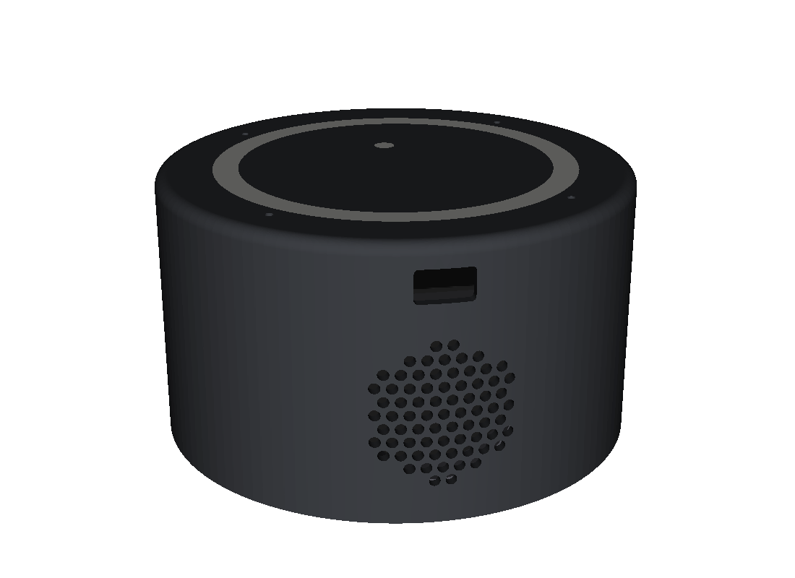
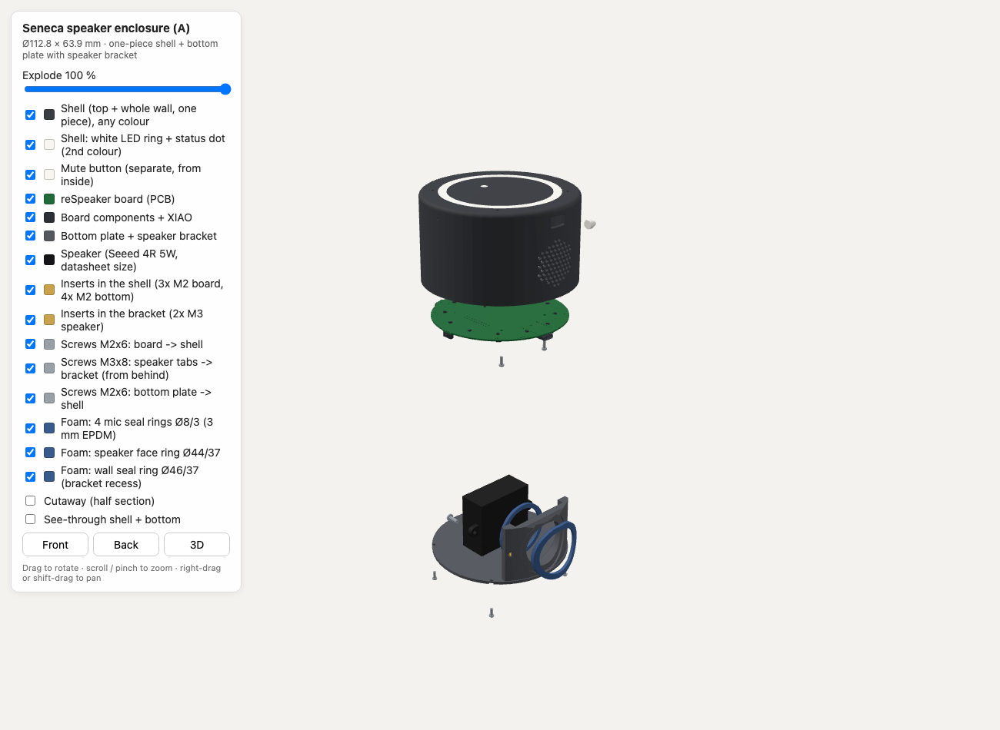
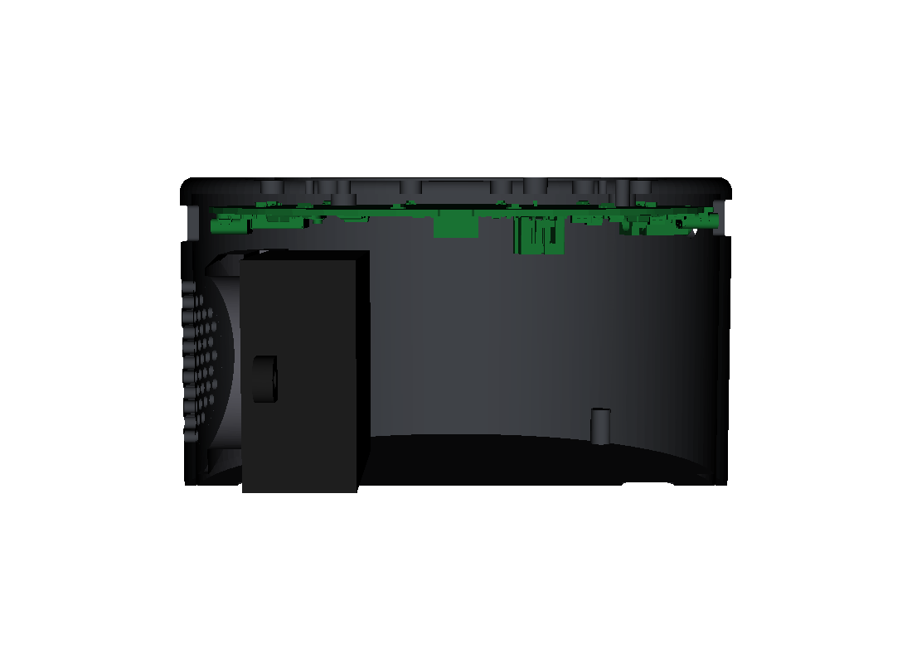

# Enclosure



A round puck, Ø112.8 × 63.9 mm (plus rubber feet), for the reSpeaker XVF3800 + XIAO ESP32-S3 and
Seeed's *Mono Enclosed Speaker 4R 5W*. It is a parametric CadQuery model: change the numbers and
regenerate. STEP files (for CAD) and STL files (for printing) are generated, not committed.

| Exploded | Section |
|---|---|
|  |  |

## Design

The enclosure has two printed parts plus a small button:

1. **Shell:** the top plate and the whole wall in one piece, so there is no side seam.
   - Two colours: `shell` in any colour plus `shell_inlay_white`, a 0.6 mm white LED ring and
     status dot, flush with the top. Ø5 light pockets under each LED reach up to the inlay.
   - Print it upside down, with the top face on the bed.
   - The board slides up from below, LED/mic side up, and is held by 3 × M2 screws into heat-set
     inserts under the top plate. Four foam rings seal the mic holes.
2. **Bottom plate** with a speaker bracket.
   - The speaker is screwed onto the bracket by its own tabs (2 × M3, from behind). This happens
     on the bench, before the plate goes in.
   - The bracket's front is curved to the wall, and a foam ring seals the cone against the grille.
   - 4 × M2 screws from below fix the plate into slim bosses at the shell's lower edge.
3. **Mute button:** a plunger inserted from the inside.

**Openings:**
- Front: speaker grille and the XIAO's USB-C (for flashing).
- Back: power USB-C and the 3.5 mm jack.
- Sides: reset pinhole and the mute button.

Every assembly step is collision-checked in the model, including the screws, inserts and foam:
- the closed device;
- the board sliding into the shell;
- the speaker moving onto the bracket;
- the loaded bottom plate sliding into the shell.

## Hardware

- Heat-set inserts: 7 × M2 (OD 3.2), 2 × M3 (OD 4.6).
- Screws: ISO 7380 button head, 7 × M2×6 and 2 × M3×8.
- Foam: 3 mm self-adhesive EPDM, cut flat. 4 mic rings Ø8/Ø3, a speaker face ring Ø44/Ø37 and a
  wall seal ring Ø46/Ø37. Printable cutting templates are generated.
- 4 stick-on rubber feet (Ø11 recesses).

A small fit-test print lets you check your printer's tolerances first. It has insert holes in
three sizes each, USB-C openings and a mic hole.

## Build

Install CadQuery in a virtual environment. Download Seeed's board STEP model from the
[XVF3800 wiki](https://wiki.seeedstudio.com/respeaker_xvf3800_introduction/) (Resources). Then:

```sh
python enclosure/enclosure_a.py --board <board.stp>        # STEP + STL into enclosure/out/
python enclosure/check_a.py --board <board.stp>            # fit + assembly-path checks (all cores)
python enclosure/render.py                                 # preview PNGs
python enclosure/viewer_build.py --board <board.stp> --three <three.module.min.js>
                                                           # self-contained 3D viewer (explode slider)
```

`enclosure.py` holds the shared parameters and geometry (board, ports, grille, LED inlay, speaker,
hardware). `check_assembly.py` provides the collision and sweep helpers that `check_a.py` uses.
