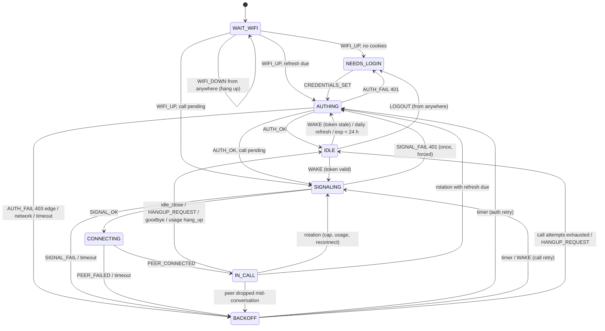

# speaker_core

Hardware-independent logic of the GPT-Live speaker firmware, in portable C11.
No ESP-IDF headers in `src/` or `include/`; the platform is injected through
`sc_platform.h` (monotonic clock, random, KV storage, logging). The only
dependency is cJSON (`json` component on ESP-IDF ≤ 5.x, `espressif/cjson` on ≥ 6.0,
vendored under `test/host/third_party/` for host builds).

```
include/            public headers (one per module)
src/                implementation
test/host/          host test runner (plain CMake + ctest, ASan/UBSan on)
  fixtures/*.json   real /wm data-channel messages (envelope included)
```

## Build and test on the host

```sh
cmake -S firmware/components/speaker_core/test/host -B /tmp/sc-build
cmake --build /tmp/sc-build
ctest --test-dir /tmp/sc-build --output-on-failure
```

On ESP-IDF, the directory is a regular component: `idf_component_register(... REQUIRES json)`.
Add `speaker_core` to your main component's `REQUIRES`.

## Threading

Nothing here is thread-safe and nothing blocks. Recommended layout: one
"controller" task owns `sc_fsm_t`, the `sc_cookie_store_t` and the
`sc_wm_tracker_t`, and drains a FreeRTOS queue of inputs (button/wake ISR,
Wi-Fi events, HTTP results, data-channel messages, a 1 s timer tick). HTTP
requests and the WebRTC peer run in their own tasks and post results back to
that queue. The httpd handlers for the setup page should also post to the
queue (or take a mutex) instead of touching the store directly.

Memory: all buffers are heap-allocated on demand and freed by the caller
(documented per function). `sc_wm_event_t` is ~800 bytes, so keep it static or
in the controller task's context rather than on a small stack.

## Modules

### `sc_platform.h`, `sc_util.h`
- `sc_kv_t {ctx, get, set, erase}`: NVS adapter. `get(buf=NULL)` reports the length;
  `set` must be durable on return (call `nvs_commit`). Keys ≤ 15 chars.
- `sc_crc32()`, `sc_b64url_decode()`, `sc_uuid_v4(out, rnd, ctx)`.

### `wm_events.h`: data-channel protocol
- `sc_wm_type_t sc_wm_decode(data, len, tracker, &ev)` unwraps up to 4 levels of
  `{"type":"data_message","data":"<json>"}` (string or object) and fills a flat
  `sc_wm_event_t`:
  - `state_update` → `new_state` / `previous_state` (`sc_rt_state_t`)
  - `chat_message_delta` → `msg.index` (`c`, -1 = current), `msg.is_add`, `msg.role`,
    `msg.author_name` (`web.run` for tools), `msg.text_op` (`SET` on add, `APPEND` for
    `/message/content/parts/N/text` appends, with or without `"o":"patch"`, and for a bare
    `{"v":"..."}`), `msg.text`, `msg.status`, `msg.direction_out`
  - `spawn_update` → `spawn_start` / `spawn_end`, `spawn_kind` (background research)
  - `usage_update` → `session_remaining_s`, `audio_remaining_s`, `hang_up`, `reconnect` (+ `reconnect_delay_s` if present)
  - `goodbye`, `close_ready`, `close_request`, `thinking_update`, `session_bootstrap`,
    `conversation_update` (best-effort `conversation_id`), `startup_telemetry`,
    `user_transcription_text`, `live_captioning_text`, `action_request`
  - other types → `SC_WM_UNKNOWN` with `type_name`; garbage → `SC_WM_INVALID`
- `sc_wm_tracker_t` (optional) remembers the role of the current message so text patches
  can be attributed (assistant caption vs. user transcript vs. tool).
- Encoders (malloc'd, `free()`): `sc_wm_encode_action("stop_speaking")` (also
  `start_listening`, `stop_listening`, `resume_listening`),
  `sc_wm_encode_relay_message(text, uuid, unix_s)`, `sc_wm_wrap(inner_json)`.

### `session_fsm.h`: lifecycle state machine
Pure: `sc_fsm_handle(&fsm, &input, &output)`. Every input carries `now_ms`
(monotonic). Feed `SC_IN_TICK` about once per second (or sleep until
`sc_fsm_next_deadline()`). Execute `output.actions`, then feed the result back.

| Action bit | Integrator does | Feed back |
|---|---|---|
| `SC_ACT_START_AUTH` (`seq`, `auth_force`) | GET `/api/auth/session` with `Cookie:` header; feed every `Set-Cookie` into `sc_set_cookie_feed`, `sc_cookies_apply_rotation`, persist via `sc_cookie_store_save_session` **before** reporting success; `sc_jwt_get_exp(accessToken)` | `SC_IN_AUTH_OK{token_exp_unix, now_unix}` or `SC_IN_AUTH_FAIL{fail}` |
| `SC_ACT_START_CALL` (`seq`, `call_is_rotation`) | create peer, build offer, `sc_session_json_build` + `sc_multipart_build`, POST `/realtime/wm?dcid=0`, apply answer | `SC_IN_SIGNAL_OK` / `SC_IN_SIGNAL_FAIL{fail}`, then `SC_IN_PEER_CONNECTED` / `_FAILED` / `_CLOSED` |
| `SC_ACT_HANG_UP` (`hangup_reason`) | close peer + data channel (idempotent) | |
| `SC_ACT_STOP_SPEAKING` | send `sc_wm_encode_action("stop_speaking")`, optionally duck playback ~350 ms | |
| `SC_ACT_SET_MIC_MUTE` / `_UNMUTE` | mute the uplink track / XVF3800 | |
| `SC_ACT_SERVE_SETUP` | make `setup.html` reachable (start SoftAP if not on Wi-Fi) | `SC_IN_CREDENTIALS_SET` after `/api/setup` stored cookies |
| `SC_ACT_CLEAR_CREDENTIALS` | `sc_cookie_store_clear` | |
| `SC_ACT_SCHEDULE_RETRY` | informational (`retry_delay_ms`); the FSM fires the retry on a tick | |

Failure classification (`sc_fail_kind_t`): `SC_FAIL_UNAUTHORIZED` = 401, or 200 without
`accessToken`/`user.email` (session dead) → **needs_login**; `SC_FAIL_EDGE` = 403 or a
`cf-mitigated` challenge → backoff starting at 15 s; `SC_FAIL_NETWORK` = DNS/TLS/timeout/5xx;
`SC_FAIL_OTHER` = other 4xx. A 401 from `/realtime/wm` triggers one forced re-auth, then backoff.

Map data-channel events to inputs: `state_update` → `SC_IN_REMOTE_STATE`;
`goodbye`/`close_ready`/`close_request` → `SC_IN_REMOTE_CLOSE`; `usage_update` →
`SC_IN_USAGE`; `spawn_update` → `SC_IN_SPAWN`; user transcripts or local VAD →
`SC_IN_ACTIVITY`.

Stale results: echo the `seq` of the output that started an attempt. Results with
another seq are ignored (seq 0 disables the check).

Policies (all in `sc_fsm_config_t`, defaults from `sc_fsm_config_defaults`, overridable
from `config/device-config.json` → `policy`):
- **Idle close**: hang up after `idle_close_s` (300) without speech. Speaking, thinking,
  listening_intently, background research and `SC_IN_ACTIVITY` all count as speech. 0 disables.
- **Rotation before the ~2 h cap**: soft deadline = min(call start + `max_call_s` − `rotate_before_cap_s`,
  last `usage_update` remaining − `rotate_before_cap_s`), or immediately on `instructions.reconnect`.
  Rotation waits for a quiet moment (not speaking/thinking/researching) but is forced
  `rotate_hard_floor_s` (15) before the cap. Rotation = `HANG_UP(ROTATE)` + `START_CALL(call_is_rotation)`;
  pass the last known `conversation_id` so the conversation continues.
- **Token/cookie refresh**: while idle, re-auth when the last success is ≥ `daily_refresh_s`
  (86400) old or the JWT expires within `token_refresh_margin_s` (86400), but never more often
  than `min_refresh_interval_s` (3600). Deferred during calls; done at the next rotation
  or after the call. Calls need ≥ 300 s of token validity, otherwise they auth first.
- **Backoff**: exponential, `base·2^(n−1)` capped at `backoff_max_ms` (300 s), "equal jitter"
  (uniform in [d/2, d]). A call gives up after `max_call_attempts` (6) and latches the error LED
  until the next wake. LED shows error after `error_led_after` (3) consecutive failures.
- **Unexpected peer drop / Wi-Fi loss** mid-conversation (activity within the idle window):
  reconnect as a rotation; otherwise go idle.



LED (`output.led`): `needs_login` (no/invalid session), `connecting` (Wi-Fi, auth for a call,
signaling, call retry), `idle`, `listening`, `thinking` (remote thinking or background research),
`speaking`, `muted` (overrides idle and in-call states), `error` (≥ 3 failures or call gave up).
Background token refreshes keep the idle LED.

### `cookie_store.h`: power-loss-safe session storage
- `sc_cookie_store_init(&st, &kv)`, `sc_cookie_store_save_session(&st, &cookies, device_id)`,
  `sc_cookie_store_load_session(&st, &cookies, device_id_buf[64])`, `sc_cookie_store_clear()`.
- Keys `sc_ck_a`, `sc_ck_b` (header: magic, generation, length, CRC32 + payload) and
  `sc_ck_act` (pointer). Save writes the inactive slot completely, then flips the pointer.
  Load takes the valid slot with the highest generation, so a crash at any byte leaves the
  previous or the new session. Payload is text lines `oai-did=<uuid>` /
  `__Secure-next-auth.session-token.N=<value>`. Use a dedicated NVS namespace; consider
  NVS encryption, since this is a full ChatGPT login.

### `set_cookie.h`: Set-Cookie parsing and Cookie header
- `sc_set_cookie_feed(&incoming, header_value)` for every `Set-Cookie` header (handles
  `Expires=` commas and comma-joined headers; ignores deletions and unrelated cookies).
- `sc_cookies_apply_rotation(&current, &incoming)`: same rule as login-with-chatgpt; returns 1 if
  the session changed, which means persist now.
- `sc_cookies_header_len()` + `sc_cookies_build_header(&c, device_id, buf, cap)`:
  `__Secure-next-auth.session-token.0=…; …session-token.1=…; oai-did=<uuid>` (chunks in index order).
  Expect around 8 KB, so raise `CONFIG_HTTPD_MAX_REQ_HDR_LEN` / esp_http_client `buffer_size_tx`.
- `sc_cookies_from_setup(&c, chunk0, chunk1)`: setup-page input (two chunks, one unnumbered
  cookie, or the Phase 0 JSON map).

### `jwt.h`
`sc_jwt_get_exp(token, &exp)` and `sc_jwt_get_string_claim(token, "client_id", buf, cap)`
(should equal `chatgpt.web_client_id` from remote config). No signature verification.

### `multipart.h`
`sc_multipart_make_boundary(b, rnd, ctx)`, `sc_multipart_content_type(b, buf, cap)`,
`sc_multipart_build(b, sdp, session_json, &body, &len)`: fields `sdp` and `session`, CRLF framing as
browsers' `FormData`.

### `session_json.h`
`sc_session_json_build(&opts)` produces exactly `buildChatGPTRealtimeSession({transport:"wm"})`
(same keys, order and defaults: voice `juniper`, `voice_mode` `wingman`,
`backend_reasoning_effort` `high`, `chat_mode` `chat`, and so on), with `voice_session_id` =
`voice_status_request_id` = a fresh UUID per call, then shallow-merges
`chatgpt.session_overrides` from remote config. `timezone_offset_min` uses JavaScript's
`getTimezoneOffset()` sign (UTC − local, −120 for CEST).

## Request headers the integrator must send (from `signaling/src/chatgpt.ts`)
- auth: `GET {base_url}/api/auth/session`, `Accept: application/json`, `Cookie`, `oai-device-id: <did>`,
  `Origin`, `Referer: {base_url}/`, `User-Agent` (Safari UA from config), `Accept-Language`.
  Use HTTP/1.1: chatgpt.com challenges HTTP/2 client fingerprints (phase0.md).
- call: `POST {base_url}/realtime/wm?dcid=0`, `Authorization: Bearer <accessToken>`,
  `chatgpt-account-id`, `Accept: application/sdp`, `OAI-Language`, `OAI-Device-Id`,
  `OAI-Client-Version`, `OAI-Client-Build-Number`, `OAI-Session-Id: <uuid>`,
  `X-OpenAI-Target-Path`/`-Route: /realtime/wm`, `Origin`, `Referer`, `User-Agent`,
  `Content-Type: multipart/form-data; boundary=…`. Success = body starts with `v=0`.
